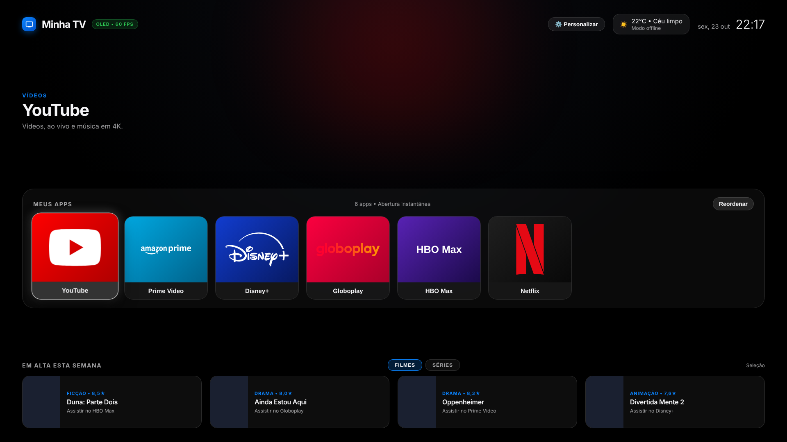

# Minha TV — tela inicial para LG webOS

Tela inicial limpa, sem anúncios e em português para a minha **LG Web TV NANO9TSA** (linha 2025, webOS 25).
Baseado no projeto [FreeMyTvWebOS](https://github.com/danielthejoker18/FreeMyTvWebOS) (licença MIT).



## O que muda em relação ao original

- Interface 100% em português (menus, avisos, clima, data, filmes em alta via TMDB em pt-BR)
- Tema **Preto OLED** como padrão
- Prateleira padrão, nesta ordem: YouTube, Prime Video, Disney+, Globoplay, HBO Max e Netflix
- HBO Max e Globoplay são reconhecidos pelo nome, mesmo que o ID do app na TV seja diferente
- Sugestões offline com títulos disponíveis no Brasil
- ID próprio do app (`com.mizael.minhatv`), então pode conviver com o Free My TV original

## Requisitos

- TV LG com webOS 3.0 ou superior (preparado para a NANO9TSA / webOS 25)
- Computador na mesma rede Wi-Fi (só para instalar)
- Python 3 e `ssh`/`scp` no computador
- Conta gratuita de desenvolvedor LG: https://webostv.developer.lge.com

## Instalação

### 1. Ligar o Developer Mode na TV

1. Na **LG Content Store**, instale o app **Developer Mode**.
2. Abra, entre com a conta de desenvolvedor LG e ligue **Dev Mode Status** (a TV reinicia).
3. Abra de novo e ligue **Key Server**. Anote o **IP** e a **senha de 6 caracteres**.

> O Developer Mode expira em cerca de 50 horas. Para renovar, abra o app e clique em **Extend**
> (o webOS Dev Manager também pode renovar automaticamente).

### 2. Instalar

```bash
git clone https://github.com/mizaelocardozo/minha-tv-webos.git
cd minha-tv-webos
python scripts/install.py
```

Ou, pela interface gráfica: instale o [webOS Dev Manager](https://github.com/webosbrew/dev-manager-desktop/releases)
(`winget install webosbrew.webOSDevManager` no Windows), conecte com IP e senha e instale
`dist/com.mizael.minhatv_1.0.0_all.ipk`.

### 3. Atalho no controle

Com a Minha TV aberta, **segure o número 1** no Magic Remote e atribua o app à tecla.
A partir daí, segurar **1** em qualquer tela abre a sua tela inicial.

## Personalizar

- **Pela TV:** botão ⚙️ **Personalizar** (apps da prateleira, aparelhos HDMI, cidade do clima, tema, chave TMDB). O botão **Reordenar** muda a ordem dos apps.
- **Pelo código:** tudo fica em `app/index.html`:
  - `DEFAULT_CATALOG` — apps conhecidos, nomes e cores
  - `DEFAULT_FAVORITES` — prateleira padrão (máx. 8)
  - `FALLBACK_MOVIES` / `FALLBACK_SHOWS` — sugestões quando não há internet ou chave TMDB

Depois de alterar, gere o pacote de novo (suba a versão em `app/appinfo.json`):

```bash
python scripts/build.py      # gera dist/com.mizael.minhatv_<versão>_all.ipk
python scripts/install.py    # instala na TV
```

## Limitações

- Sem root, o botão **Home** físico continua abrindo a tela da LG; a Minha TV abre pelo atalho do número **1**.
- A tela de fábrica não é alterada — para voltar ao original basta desinstalar o app.

## Licença

MIT — veja [LICENSE](LICENSE). Créditos ao projeto original de danielthejoker18.
