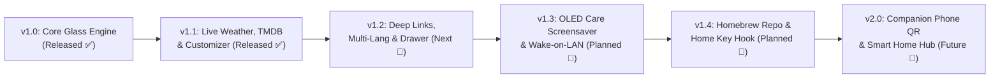

# 🗺️ Free My TV (webOS) — Product Roadmap

Our mission is to provide every LG Smart TV owner (webOS 3.0 through webOS 24+) with an instantaneous, zero-ad, 60fps home screen that respects their hardware and privacy.

---

## 📈 Release Timeline

---

## ✅ Completed Milestones

### v1.0 — The 60fps Frosted Glass Foundation
- [x] Zero-dependency HTML5/CSS3 hardware-accelerated Frosted Glass UI.
- [x] Direct Luna Bus integration (`luna://com.webos.applicationManager/launch`) for ~100ms native app launching.
- [x] Full LG Magic Remote pointer + D-Pad spatial keyboard navigation (`Arrow` keys, `Enter`, and `Back` button `keyCode 461`).
- [x] Automated local network SSDP discovery & one-command Python installer (`scripts/install.py`).
- [x] Standalone pure-Python `.ipk` compiler fallback (`scripts/build.py`).

### v1.1 — Dynamic Live Data & On-TV Personalization
- [x] **On-Screen Shelf Customizer:** Auto-discovers installed apps directly from the TV OS (`listLaunchPoints`) and lets users toggle favorites with the remote.
- [x] **Live Open-Meteo Weather & Sunset Engine:** Auto-detects location (or custom city) and shifts background ambiance between *Daylight Blue*, *Sunset Amber*, *Deep Midnight*, and *Pure OLED Black*.
- [x] **TMDB & Zero-Key Live Trending Row:** Supports personal TMDB API keys with an automatic zero-key live fallback feed for top-rated shows.

---

## 🚧 Upcoming Milestones

### v1.2 — Deep-Linking, Quick Drawer & Localization (Next Up)
- [ ] **Direct Content Deep-Linking:** Clicking a trending movie or show opens the exact title page directly inside Netflix, YouTube, Disney+, Prime Video, or Plex (`contentTarget` payload).
- [ ] **Drag-and-Drop / D-Pad Reordering:** Reorder app tiles directly on the shelf using long-press `Enter` + Left/Right arrows.
- [ ] **Native App Icon Extraction:** Render local TV resource icons (`https://127.0.0.1:3001/resources/...`) alongside custom minimalist vector badges.
- [x] **Slide-Out Info Drawer *(landed early)*:** Clicking the weather widget opens a panel with an hourly forecast (6 hours) and sunrise/sunset times, powered by Open-Meteo. Live market/sports scores are not included.
- [x] **Movies / Shows Trending Tabs *(not originally planned, added early)*:** The trending row is now two tabs instead of one mixed list — TMDB-ranked when a key is set, TVMaze's live feed for Shows with no key, curated picks for Movies with no key.
- [ ] **Multi-Language Support:** Built-in localization for English (`en`), Portuguese (`pt-BR`), Spanish (`es`), German (`de`), and French (`fr`).

### v1.3 — OLED Care Screensaver & PC Wake-on-LAN
- [x] **Idle Screensaver & Clock Overlay *(landed early, partial)*:** A pure-black, OLED-safe screensaver with a floating clock that pixel-shifts position every ~25s kicks in after 3 minutes idle. The curated 4K photo-backdrop variant is still pending.
- [ ] **Wake-on-LAN (WoL) PC Tile:** Turn on your gaming PC or home media server automatically when clicking the HDMI / Plex tile.
- [ ] **System Debloat Helper:** Optional one-click toggle inside Settings to mute LG promotional notifications and clear background app memory. Needs root (Homebrew Channel) — this app runs unrooted, so it cannot touch system services on its own.

### v1.4 — Official Homebrew Channel Repo & Home Button Hook
- [ ] **Publish to `webosbrew.org` Repository:** Allow any user with the Homebrew Channel to install and update **Free My TV** in one click directly on their TV.
- [ ] **Optional Physical Home Button Hijack (Root / Autostart):** For rooted TVs, optionally bind the physical `Home` button on the Magic Remote directly to **Free My TV** instead of `com.webos.app.home`.

### v2.0 — Companion QR Setup & Smart Home Integration
- [ ] **QR Code Phone Companion:** Scan a QR code on the TV screen to type API keys, reorder apps, or push custom URLs from your smartphone browser.
- [ ] **Home Assistant / MQTT Integration:** Optional webhook/status bridge for smart room lighting scenes when launching movies.

---

## 🤝 Contributing

Have an idea or want to tackle an item on the roadmap?
1. Fork the repository.
2. Edit [`app/index.html`](app/index.html).
3. Test in any desktop browser or package with `python scripts/build.py`.
4. Submit a Pull Request!
